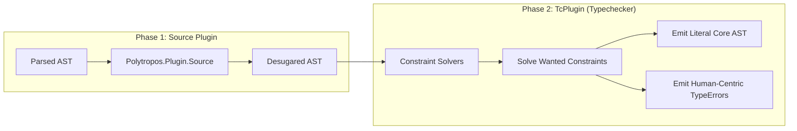

<!--
SPDX-License-Identifier: EUPL-1.2 OR Apache-2.0
-->
# `polytropos` Maintainer Guide & Architectural Governance

**Status:** LIVING DOCUMENT · v1.1 · 2026-10-11  
**Audience:** Maintainers, Subsystem Leads, Ecosystem Contributors, AI Assistant Drivers  
**Canonical Strategy:** [`docs/notes/DOC_STRATEGY.md`](notes/DOC_STRATEGY.md) · [`docs/notes/POLYTROPOS_DESIGN.md`](notes/POLYTROPOS_DESIGN.md)  
**Corpus Inventory:** [`docs/INDEX.md`](INDEX.md) · **Package Register:** [`docs/registers/PACKAGES.md`](registers/PACKAGES.md)  
**Newbie Guide:** [`docs/NEWBIE_GUIDE.md`](NEWBIE_GUIDE.md) · **Tutorial:** [`docs/TUTORIAL.md`](TUTORIAL.md)

---

## 1. Architectural Foundations & Invariants

### 1.1 The Single-Representation Doctrine (`Rep`)
The central thesis of `polytropos` is that the nominal/structural design space collapses into a single mechanism:
```haskell
data Rep (f :: Type -> Type) a = Rep
  {-# UNPACK #-} !Word
  !(SmallArray (f Any))

repTag  :: Rep f a -> Word
repVals :: Rep f a -> SmallArray (f Any)
```

- **Products (Records):** `repTag` is identically `0`. The `SmallArray` stores all $N$ field values consecutively. Memory overhead is identical to a standard nominal data constructor with $N$ strict fields.
- **Sums (Variants):** `repTag` stores the active constructor index ($0, 1, 2, \dots$). The `SmallArray` stores that constructor's payload fields.
- **Positional Representation & Accessors:** `Rep` uses positional constructor fields rather than named record selectors. Field projection is accessed via top-level accessor functions (`repTag`, `repVals`) to prevent selector collisions in consumer modules (enforcing §3 Recipe 3).
- **Typed Wrapper (`RowRep`):** To avoid passing untyped `Rep` values to consumer code, `RowRep f flavour row a` wraps `Rep` at the type level. The row type is purely phantom at runtime; no type-level dictionary searching or linked-list traversal ever occurs during evaluation.

### 1.2 Zero-Contamination Doctrine
1. **Zero Assistant Tooling in Cabal:** Developer tooling (`tricorder`, `contextful`, `ast-grep`, `hasktags`) must **never** be added as dependencies to `cabal.project` or the `.cabal` files in `packages/`.
2. **Pristine Core Builds:** Any contributor cloning the repo must be able to build and pass all tests under the **Tier 0 POSIX Baseline** (`cabal build all`, `cabal test all` on GHC 9.14.1 / Cabal 3.18) without any background daemons installed.
3. **Job Parallelism:** Always compile and test with `--jobs` (e.g. `--jobs=20` on multicore host runners) to maximize throughput.

---

## 2. The `Polytropos.Plugin` Architecture

The typechecker plugin (`packages/polytropos-plugin/src/Polytropos/Plugin.hs`) is the load-bearing component that gives `polytropos` its compile-time performance advantage (Arm P: 122× reduction in Core vs unassisted search; Arm PR: linear $\mathcal{O}(N)$ exponent 1.03).

### 2.1 The Two-Phase Plugin Pipeline



1. **Source Plugin (`Polytropos.Plugin.Source`):**
   - Intercepts the raw `HsParsedModule` before renaming and typechecking.
   - Desugars syntactic sugar (`REC { ... }`, `REC_F { ... }`, `VAR { ... }`, `REC_UPD`, and view patterns) into core combinators (`emptyRecord`, `insertField`, `injectVariant`, `projectVariant`, `setField`).
   - Strips `deriving (OpenRecord, OpenVariant)` clauses while recording constructor names so standard GHC stock deriving does not fail.

2. **TcPlugin (`Polytropos.Plugin`):**
   - Runs during GHC constraint solving.
   - Intercepts wanted constraints for `FieldIndex`, `ConstructorIndex`, `AllFields`, `SubRow`, `SubSum`, `KnownHash`, and `HasField`.
   - Solves them in native compiled Haskell code and emits literal constants directly into Core AST expressions.
   - If a constraint cannot be solved, intercepts the failure and synthesizes a formatted, human-centric `TypeError` with Levenshtein-distance fuzzy suggestions.

### 2.2 Constraint Solvers Breakdown

| Class | Solved Constraint | Emitted Core Evidence |
|---|---|---|
| `FieldIndex name row a` | Determines 0-indexed slot offset of field `name` | Literal `Int` index dictionary |
| `ConstructorIndex tag row` | Determines 0-indexed tag of constructor `tag` | Literal `Word` tag dictionary |
| `GHC.Records.HasField name (Record row) a` | Solves `OverloadedRecordDot` (`r.name`) field lookup | Literal $\mathcal{O}(1)$ array index selector lambda |
| `AllFields c row` | Supplies type-erased dictionaries for all fields | Pre-allocated `SmallArray (DictAny c)` |
| `SubRow sub super` | Verifies field subset; computes projection map | Literal integer list `[Int]` |
| `SubSum sub super` | Verifies constructor subset; computes injection & narrowing maps | Literal `[Word]` (inject) and `[Maybe Word]` (narrow) |
| `KnownHash sym` | Computes compile-time FNV-1a 64-bit label hash | Literal `Word` hash dictionary |

---

## 3. Maintenance Recipes

### Recipe 1: How to Add a New Evidence Class
When adding a new type-level capability:
1. **Define the class in `Polytropos.Core`:** Keep method implementations default to `undefined` or a runtime assertion. Ensure the class is parameterized over `(row :: RowType)` or `(r :: Row)`.
2. **Register the Class Name in `PluginState`:** In `packages/polytropos-plugin/src/Polytropos/Plugin.hs`, look up the `Class` in `tcPluginInit` via `findImportedModule` and `tcLookupClass`.
3. **Implement the Solver:** Add a dedicated solver function `solveMyClass :: PluginState -> Ct -> TcPluginM (Maybe (EvTerm, Ct))`.
4. **Emit Literal Core AST:** Construct evidence using `mkCoreConApp` or `mkCoreLams`. Never emit Core that calls recursive typeclass dictionaries.
5. **Add Smoke Tests:** Add unit tests to `packages/polytropos-plugin/tests/smoke/Main.hs` verifying both compilation and runtime execution.

### Recipe 2: Creating a New Ecosystem Satellite Package
To add a new satellite package (e.g. `polytropos-servant` or `polytropos-esqueleto`):
1. **Follow the Package Register:** Read [`docs/registers/PACKAGES.md`](registers/PACKAGES.md).
2. **Directory Placement:** Create `packages/polytropos-<satellite>/`.
3. **Cabal Conventions:**
   - Must specify `ghc-options: -Wall -Werror`.
   - Build-depend on `base`, `polytropos-core`, and `polytropos-plugin`.
   - Add a test suite `test/Main.hs` with `tasty` and `tasty-hunit`.
4. **Register in Workspace:**
   - Automatically included via `packages: packages/*/` in `cabal.project`.
   - Record in `docs/registers/PACKAGES.md` and `STATE.md`.
5. **Verify with Deterministic Gate:** Run `cabal test --jobs=20 polytropos-<satellite>-test` and ensure zero warnings.

### Recipe 3: Debugging Plugin Panics & Core Lint Errors
If GHC panics or Core Lint reports an invalid Core expression emitted by the plugin:
1. **Enable Detailed Tracing:**
   ```bash
   cabal build polytropos-plugin-smoke --ghc-options="-ddump-tc-trace -dcore-lint"
   ```
2. **Inspect Emitted Core:**
   ```bash
   cabal build polytropos-plugin-smoke --ghc-options="-ddump-ds -ddump-simpl"
   ```
3. **Common Pitfalls:**
   - **Type Mismatches in `EvTerm`:** Ensure the type of the emitted expression matches the exact expected dictionary type `ctEvPred (ctEvidence ct)`.
   - **Module Namespace Drift in GHC 9.14:** In `base-4.22`, classes like `Show` or `Eq` reside internally in `GHC.Internal.Show` and `GHC.Internal.Data.Eq`. Always verify wire names via `resolveImport`.
   - **Unused Selector Mangling:** Access top-level accessor functions (`repTag`, `repVals`) rather than record fields to prevent selector collisions.

---

## 4. Documentation Precedence & The Two-File Loop

1. **Precedence Doctrine:**
   Per [`docs/notes/DOC_STRATEGY.md`](notes/DOC_STRATEGY.md) §4:
   > *Code wins at runtime; documentation notes must be corrected in the same change set.*
   If an implementation decision diverges from a design doc, update both the code and the design note together.

2. **The Two-File Loop (`PLAN.md` & `STATE.md`):**
   - Before ending a coding session or handing off tasks, always update [`STATE.md`](../STATE.md) with exact test counts, current operational frontiers, and next actions.
   - Fresh sessions always bootstrap from [`PLAN.md`](../PLAN.md) and [`STATE.md`](../STATE.md).

3. **`AGENTS.md` Context Budget:**
   [`AGENTS.md`](../AGENTS.md) has an inviolable ~4 KB budget to prevent attention degradation in AI assistants. Add links, never duplicate technical content.

---

## 5. Git Commit Protocol & AI Attribution

All commits must follow the imperative-subject plus HEREDOC explanatory body schema enforced by `.githooks/commit-msg`:

```gitcommit
Short imperative subject line (<=72 chars)

Explanatory body explaining the problem statement, design rationale,
and invariants preserved.

Assisted-by: <Tool> (<Provider> / <Model>)
Orchestrated-by: <Engine>
```

**Legal Safeguards:**
- **NEVER** use `Co-authored-by:` or `Signed-off-by:` for AI assistants.
- Only human developers can certify the Developer Certificate of Origin (DCO).

---

## 6. Open Correction Process for Maintainers

This guide is a living document. We actively encourage maintainers and contributors to revise, correct, and update architectural explanations and recipes as GHC evolves:
- When a new GHC major release alters wired-in module names, record the change in §3 Recipe 3.
- When a new satellite package pattern emerges, document it in §3 Recipe 2.
- If any explanation appears clunky or outdated, submit a pull request or patch immediately!
