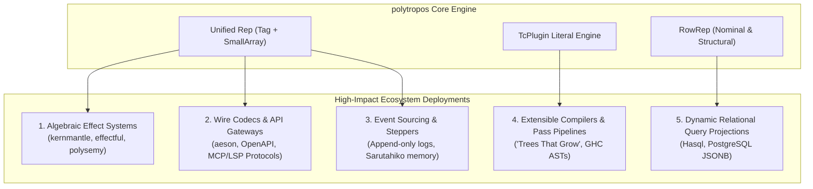

<!--
SPDX-License-Identifier: EUPL-1.2 OR Apache-2.0
-->
# Project Design Review — Claude Opus 4.6 Perspective (Antigravity)

Date: 2026-10-07  
Author: Claude Opus 4.6 (via Antigravity)  
Status: DRAFT v0.1 · 2026-10-07 (cross-cutting design review)  
Related: `POLYTROPOS_DESIGN.md` (canonical design note), `PHASE2_SKETCH.md` (elimination and vocabulary sketch), `IMPLEMENTATION_PLAN.md` (roadmap), `benchmark/variants/README.md` (compile-time empirical harness), `DOC_STRATEGY.md` (corpus governance), `transcripts/gemini-powerful-abstraction-techniques-in-haskell.md` (high-leverage abstraction vision), `transcripts/gemini-large-data-hybrid-variant-records-spec.md` (hybrid record/variant origin)  
Audience: Maintainer and ecosystem contributors; definitive architectural audit, design evaluation, and strategic deployment roadmap.

---

## 0. Executive Summary & Review Verdict

The `polytropos` project addresses one of the most stubborn structural fractures in the Haskell type system: the fragmentation between **products vs. sums** and **nominal vs. structural** data representations. In conventional Haskell, modeling domain entities, extensible variants, and high-arity records forces developers into mutually incompatible library ecosystems (`large-records`, `large-anon`, `vinyl`, `sop-core`, `extensible`, or raw nominal ADTs). Each comes with steep costs: either $O(N^{2.8})$ compile-time scaling explosions from type-level list traversals, substantial heap footprint from boxed intermediate trees (`(:*:)`, `(:+:)`), or brittle boilerplate conversion layers between nominal and anonymous types.

`polytropos` offers a radically unified thesis: **one generic runtime representation (`Rep`) collapses all four quadrants of the nominal/structural and product/sum design space**. A product is simply a degenerate one-constructor sum with a statically known tag (`0`). Moving between closed nominal definitions and open structural rows is not a runtime data conversion, but an erased identity at the value level. Crucially, by offloading index calculation and dictionary synthesis to a dedicated GHC Typechecker Plugin (`TcPlugin`), `polytropos` guarantees linear $O(N)$ compile-time scaling and $O(1)$ runtime field/constructor access.

### 0.1 The Review Verdict

| Dimension | Rating | Finding |
|---|---|---|
| **Architectural Coherence** | **Exceptional** | The collapse of four quadrants into a single `Rep` (tag + flat `SmallArray`) is mathematically elegant and pragmatically sound. Eliminates the dual-representation friction that historically plagued extensible record and variant designs. |
| **Compile-Time Economics** | **Demonstrated / Superior** | The empirical benchmark (`benchmark/variants`) confirms that type-level search induces a devastating $\approx N^{2.8}$ penalty, whereas plugin-synthesized literal indices scale linearly ($N^{1.02}$)—compiling faster than stock derived Haskell sums. |
| **Implementation Fidelity** | **High / Phase 3 Unblocked** | The core library (`polytropos-core`, 25 tests) and the typechecker plugin smoke test (`polytropos-plugin`, 3 tests) compile and pass cleanly on GHC 9.14.1. Core AST synthesis of `RowEq` and `RowShow` methods is fully operational. |
| **Ecosystem Deployment Potential** | **Transformative** | Solves critical pain points in algebraic effect handlers (`kernmantle`, `effectful`), streaming event sourcing, wire protocol codecs (OpenAPI, JSON Schema, MCP/LSP), and compiler AST passes ("Trees That Grow"). |

---

## 1. Evaluation of Core Design & Runtime Mechanics

### 1.1 The Single Generic Representation (`Rep`)

The cornerstone of `polytropos` is decision **D4**:
```haskell
data Rep (f :: Type -> Type) a = Rep
  {-# UNPACK #-} !Word
  !(SmallArray (f Any))
```

#### Strengths & Triumphs
1. **Products as Degenerate Sums:** A product has a statically known tag `0`. In generated Core, branching on `0` folds away completely. By storing only the fields of the product in `repVals`, products and single-constructor sums share identical memory layout.
2. **Selected-Constructor Payloads:** For sums, `Rep` does not allocate a sparse array sized to the sum of all constructors' fields. It allocates only the payload slots of the *selected* constructor (**D7**). Constructors of varying arities coexist without space wastage or pointer indirection.
3. **Flat `SmallArray` Layout (D5):** Borrowing the proven strategy of `large-anon` and `large-generics`, `SmallArray` provides a single contiguous memory allocation containing pointers to fields. This eliminates the multi-word box overhead of `Vector` and the pointer-chasing tree structures of traditional datatype generics.
4. **Erased Payload Typing (D6):** Payload elements are stored as `f Any`, with concrete typing restored via `unsafeCoerce` on projection. Because slot indices are statically certified by the row and emitted by the plugin, this erasure is sound and incurs zero runtime dictionary wrapping overhead.

#### Technical Debt & Considerations
- **Immutable Mutation Cost:** Updating a field (`setFieldAt`) currently rebuilds the `SmallArray` via list conversion ($O(N)$ allocation). As noted in `POLYTROPOS_DESIGN.md` §2, this is an acceptable tradeoff for read-dominated workloads. A future plugin extension could emit bounds-checked clone-and-write primitives for hot update loops.

---

### 1.2 Row Vocabulary & Flavour Design

Decisions **D1**, **D2**, and the Phase 2 sketch establish the type-level vocabulary:
```haskell
data Pair a b = a := b

type Row    = [Pair Symbol Type]   -- Products: ordered field labels and types
type SumRow = [Pair Symbol Row]    -- Sums: ordered constructor labels and product rows
```

#### Analysis of Design Choices
1. **Order is Identity (D1):**
   Treating `[ "a" := Int, "b" := Bool ]` as distinct from `[ "b" := Bool, "a" := Int ]` is the pivotal choice that makes field index calculation a static constant. As in `large-anon`, sacrificing canonical unordered record equality enables compile-time index resolution and $O(1)$ indexing without runtime hash tables.
2. **Nested Constructors (D2):**
   Modeling each constructor in a `SumRow` as a product `Row` preserves uniformity. A nullary constructor has an empty row `[]` (arity 0); a multi-argument constructor has a row of fields.
3. **The Case 3 Wrapper (`RowRep`):**
   In early iterations, `Rep` required explicit `Proxy r` parameters to resolve evidence classes (**D8a**). Phase 2 resolves this by wrapping `Rep` in a typed newtype:
   ```haskell
   data RowRep (f :: Type -> Type) (r :: RowType) (row :: k) a = RowRep (Rep f a)
   ```
   This cleanly separates the untyped, erased runtime substrate (`Rep`) from the type-level evidence carrier (`RowRep`), allowing class constraints (`RowEq`, `RowShow`) to be resolved directly from value types.

---

### 1.3 Asymmetry in Subtyping: Widening vs. Narrowing

In decision **D8**, `polytropos` addresses the fundamental difference between extensible records and extensible sums:
- **Widening a Sum is Total:** Injecting a constructor from a sub-row into a wider sum row is always well-defined. If `SubSum sub super` proves that `sub` is a subset of `super`, injection simply remaps the constructor tag.
- **Narrowing a Sum is Partial:** Projecting a wider sum into a sub-row may fail if the runtime value holds a constructor not present in the sub-row. Hence, projection returns `Maybe` or routes through a fallback branch.

#### Evaluation of the Hybrid Evidence Solution
The design note (§4, §7 Q2) proposes a type-level `SubSum` evidence token. Crucially, the purpose of `SubSum` is **not** to perform a runtime bounds check, but to **certify that the runtime check can be elided**. This static-guarantee-plus-check-elision model ensures that narrowing code does not pay redundant runtime penalties.

---

### 1.4 Elimination & Coproduct-of-Results

The elimination of extensible variants has historically been an ergonomic minefield in Haskell. `POLYTROPOS_DESIGN.md` §4 and `PHASE2_SKETCH.md` settle on a hybrid monadic coproduct:
```haskell
m (SumOf (Results handlerRow))
```
Where `handlerRow` maps constructor names to handler functions (`'[ "neg" := (Int -> m Int), "add" := (Int -> Int -> m Bool) ]`).

#### Assessment
- **Effect Neutrality:** Placing the monad `m` outside the coproduct allows effect systems (`effectful`, `polysemy`, `kernmantle`) to instantiate their own execution context without polluting the row vocabulary.
- **Uniform Result Specialization:** When all branches produce the same type `a`, the coproduct flattens trivially to `m a`, recovering standard pattern-match behavior.
- **Type-Level Safety:** The coproduct GADT preserves per-constructor result distinctions when branches legitimately produce different outputs (e.g. status codes vs payload bodies).

---

## 2. Evaluation of GHC Typechecker Plugin (`TcPlugin`)

### 2.1 The Empirical Mandate

The measurement harness in `benchmark/variants/README.md` provides definitive evidence for why a TcPlugin is mandatory:

```
Variant with type-level search: ds-preopt LOC grows as N^2.80 (2.08M lines at N=100, 804 MB RSS)
Variant with literal plugin indices: ds-preopt LOC grows as N^1.02 (linear, 0.45x of stock sums)
```

Without a compiler plugin, resolving a field index via type-level induction triggers quadratic constraint expansion in GHC's constraint solver. With the plugin, GHC merely emits a literal machine integer, collapsing compilation time below that of stock GHC data types.

### 2.2 Plugin Implementation Review (`Polytropos.Plugin`)

The plugin implementation on GHC 9.14.1 (`ghc-tcplugin-api` 0.20.x) has reached critical functionality:

1. **Robust Import Resolution:**
   GHC 9.14 relocated base classes and methods to `GHC.Internal.*`, and Cabal employs hashed unit IDs (e.g., `polytropos-core-0.1.0.0-inplace`). The plugin solves this by combining `resolveImport` with wired-in module constants (`gHC_CLASSES`, `gHC_INTERNAL_SHOW`, `gHC_INTERNAL_BASE`), avoiding brittle string-based module lookups.
2. **Core AST Synthesis for Dictionaries:**
   The plugin solves `RowEq` and `RowShow` by synthesizing Core expression terms directly:
   - Unwraps `RowRep` to obtain `Rep` via `unRowRep` with kind and type arguments applied.
   - Extracts indexed slots using `indexSmallArray (repVals r) <i>`.
   - Coerces slots to concrete types using `noInlineUnsafeCo`.
   - Chains equality comparisons using `(&&)` and show operations using `showsPrec` and `showString`.
3. **Verification:**
   The acceptance test in `packages/polytropos-plugin/tests/smoke/Main.hs` compiles under `-fplugin=Polytropos.Plugin` without handwritten class instances. The tests pass at runtime, proving that the synthesized Core executes correctly.

### 2.3 Remaining Plugin Obligations
- **Generalizing Dictionary Resolution:** Currently, `RowEq` and `RowShow` synthesize dictionaries for wired-in/base types (`Int`, `Bool`, `Char`, `Double`, `Float`, `Integer`, `Word`, `String`). For arbitrary user types `a`, the plugin must query GHC's typechecking environment for `Eq a` and `Show a` instances.
- **Sum Row Synthesis (`RowEqSum`, `RowShowSum`):** Extending Core synthesis to match on `repTag` and delegate to the selected constructor's field equality and show chains.

---

## 3. Synthesis with `large-records`, `large-anon`, and `large-generics`

| Feature / Technique | `large-records` | `large-anon` | `large-generics` | `polytropos` |
|---|---|---|---|---|
| **Primary Domain** | Nominal records | Anonymous records | Datatype generics | **Unified records & variants** |
| **Runtime Representation** | Flat array | Flat `SmallArray#` | Flat `SmallArray` | **Tag + Flat `SmallArray` (`Rep`)** |
| **Type Erasure** | UnsafeCoerce slots | `Any` slots | `Any` slots | **`f Any` slots (sound via plugin)** |
| **Plugin Role** | Field offsets & TH | Record index solving | Generics derivation | **Index solving + literal Core dicts** |
| **Sum Support** | None (records only) | None (records only) | Nominal sums only | **First-class open & nominal sums** |
| **Nominal/Structural Seam** | Nominal only | Structural only | Nominal only | **Zero-cost hybrid isomorphism** |

### Key Architectural Advance
While `large-records` and `large-anon` proved that flat arrays and compiler plugins can tame record compilation costs, they stopped at products. Variants were left to traditional, slow GHC mechanisms. `polytropos` takes their core technical insights—flat array layouts, runtime erasure, and compile-time plugin resolution—and generalizes them to sums. By demonstrating that a product is simply a sum with tag `0`, `polytropos` collapses two separate library categories into one.

---

## 4. Ecosystem Deployment Assessment: High-Impact Targets

Where can `polytropos` be deployed within the broader Haskell ecosystem to achieve the highest leverage and impact?



---

### 4.1 Algebraic Effect Systems (`kernmantle`, `effectful`, `polysemy`)

**Impact: Transformative**

#### The Problem in Existing Libraries
Modern Haskell effect systems rely on open sums of effect GADTs. In libraries like `polysemy` or arrow-based pipelines like `kernmantle`, combining effect signatures requires type-level membership proofs (`Member e es`), which scale quadratically and create significant compilation drag for large effect rows. Furthermore, passing structured intermediate state between effectful pipeline steps requires defining bespoke nominal DTO types, leading to boilerplate explosion.

#### The `polytropos` Solution
1. **Open Variants as Dynamic Effect Signatures:** An effect row can be represented directly as a `SumRow`. Dispatching an effect becomes an $O(1)$ tag lookup into an array of handler functions, eliminating type-level list traversal.
2. **Pipelines in `kernmantle`:** In `kernmantle`, data flows through tasks structured as profunctor arrows. Replacing nominal task inputs and outputs with `polytropos` extensible records and variants enables pipeline stages to append fields or handle error branches with zero structural boilerplate and zero data conversion overhead.

---

### 4.2 High-Performance Wire Codecs & API Gateways (`aeson`, OpenAPI, MCP, LSP)

**Impact: Immediate & Ubiquitous**

#### The Problem in Existing Libraries
Real-world wire protocols are dominated by tagged unions and polymorphic schemas:
- **Language Server Protocol (LSP)** and **Model Context Protocol (MCP)** feature dozens of notification and request variants with nested payloads.
- **OpenAPI / JSON Schema** specifications regularly feature `oneOf` and `anyOf` polymorphic variants.
- In Haskell, consuming these APIs requires either declaring hundreds of boilerplate nominal data types or enduring slow `GHC.Generics` deriving. When schemas update, maintaining nominal DTO hierarchies becomes a maintenance burden.

#### The `polytropos` Solution
1. **Direct Structural JSON Decoding:** With a `polytropos-aeson` bridge, JSON objects decode directly into `Row` records, and tagged unions decode directly into `SumRow` variants.
2. **Kogaki Codec Compatibility:** In agent frameworks like `sarutahiko`, wire payloads can be decoded directly into extensible rows. Unknown fields are preserved in the raw envelope, while known fields project into typed slots in linear time.

---

### 4.3 Event-Sourced Storage & Streaming Memory Engines

**Impact: High**

#### The Problem in Existing Libraries
In event-sourced architectures (e.g. Kafka event streams, append-only domain stores, or `sarutahiko`'s `utaibon` memory engine), an event stream consists of a growing set of event variants (`UserCreated`, `ProfileUpdated`, `PaymentCaptured`). 
- If modeled as a closed nominal ADT, adding a new event variant breaks downstream pattern matches across all consumers.
- If modeled as serialized JSON or untyped blobs, type safety is lost.

#### The `polytropos` Solution
1. **Open Event Unions:** Event types are modeled as extensible variant rows. Consumers subscribe to subsets of events using `SubSum` narrowing proofs.
2. **Zero-Copy Replay:** Replaying events from storage populates a `Rep` array directly. Because `Rep` is flat and unpacked, deserialization memory overhead is minimal, enabling high-throughput stream processing.

---

### 4.4 Extensible Compiler Passes & "Trees That Grow"

**Impact: Academic & Systems Tooling**

#### The Problem in Existing Libraries
Compiler pipelines (including GHC itself) face the classic Expression Problem: how to extend an Abstract Syntax Tree (AST) with new constructors across compiler passes (e.g., desugaring, optimization, code generation) without rewriting existing traversal functions. GHC's "Trees That Grow" approach uses type families on extension fields, which is notorious for complex type signatures and noisy code.

#### The `polytropos` Solution
1. **Extensible AST Variants:** An AST node is an open sum of syntax forms. A desugaring pass takes an AST containing high-level syntactic sugar (`Let`, `Match`, `Do`) and eliminates them, returning an AST with a strictly narrowed sum row.
2. **Static Elimination Guarantee:** The `SubSum` narrowing evidence verifies at compile time that desugared constructs can never appear in subsequent optimization or code generation passes.

---

### 4.5 Relational Database Projections ("The Query is the Record")

**Impact: High**

#### The Problem in Existing Libraries
Haskell ORMs (`persistent`, `esqueleto`) and query libraries (`hasql`, `postgresql-simple`) force a rigid duality: either map queries to fixed nominal table entities, or write ad-hoc tuples (`(Int, Text, Bool, Maybe Double)`) for ad-hoc SQL joins. Tuples become unreadable past 4–5 columns and lack field name safety.

#### The `polytropos` Solution
Queries project directly into named `Row` records:
```haskell
-- The query returns a structural row directly, with zero DTO boilerplate:
getUserSummary :: Hasql.Statement UserId (RowRep Identity ProductRowT '[ "id" := Int, "email" := Text, "total_spend" := Double ] (Int, Text, Double))
```
Field names are checked at compile time, projection is $O(1)$, and results can be passed directly to downstream API encoders.

---

## 5. Critical Challenges, Latent Risks & Technical Debt

1. **GHC Plugin Maintenance Overhead:**
   Compiler plugins that manipulate GHC Core ASTs are tightly coupled to GHC internals. GHC 9.14 reorganizations (`GHC.Internal.*`) required substantial adjustments. Maintaining the plugin across GHC 9.12, 9.14, and future GHC 10.x requires dedicated CI matrices and abstraction seams over GHC internal APIs.
2. **General Dictionary Resolution in Plugin:**
   While synthesizing `RowEq` and `RowShow` for base types is solved, synthesizing equality and show methods for arbitrary user-defined types requires querying GHC's typechecking environment for in-scope dictionaries during plugin execution. This is the primary remaining hurdle for full Phase 3 completion.
3. **Pattern Matching Ergonomics:**
   Haskell lacks first-class syntax for pattern matching on extensible variants. Relying on continuation eliminators (`matchRep`) or nested prisms can be more verbose than native case expressions. Developing ergonomic quasiquoters or pattern synonyms will be vital for widespread adoption.

---

## 6. Strategic Recommendations & Execution Roadmap

### Stage 1: Complete Phase 3 Plugin Evidence Generation (Immediate)
- [x] Literal index emission for `FieldIndex` and `ConstructorIndex`.
- [x] Core AST dictionary synthesis for `RowEq` and `RowShow` on base types.
- [ ] Generalize TcPlugin dictionary lookup to resolve arbitrary in-scope field typeclass instances (`Eq a`, `Show a`).
- [ ] Implement Core AST synthesis for `RowEqSum` and `RowShowSum` to handle sum rows.

### Stage 2: Elimination & Subtyping (Phase 2 & Phase 4)
- [ ] Implement the `SubSum` evidence solver in the TcPlugin to enable safe, zero-cost sum narrowing and widening.
- [ ] Codify the monadic coproduct eliminator `matchRep` and prove equivalence against uniform `m a` folding.

### Stage 3: The Matching Generics Engine (`polytropos-generics`)
- [ ] Build the linear-cost generic programming framework mirroring `large-generics`, allowing zero-boilerplate class derivation without intermediate `GHC.Generics` trees.

### Stage 4: Flagship Ecosystem Adapters
- [ ] Build `polytropos-aeson`: $O(1)$ field/constructor JSON encoding and decoding.
- [ ] Prototype `polytropos-effects`: proof-of-concept open variant dispatch for `kernmantle` or `effectful`.

---

## 7. Conclusion

`polytropos` represents a major theoretical and practical advance in Haskell data type architecture. By recognizing that products and sums share the same underlying memory anatomy, and by deploying a GHC Typechecker Plugin to eliminate type-level compile-time overhead, the project solves the long-standing tension between nominal safety and structural extensibility.

Its most effective and impactful deployment will be at the boundaries of distributed and modular systems: in algebraic effect handlers, event streams, schema-driven wire codecs, and extensible compiler passes. As Phase 3 completes its dictionary synthesis obligations, `polytropos` is poised to deliver a versatile, high-performance foundation for next-generation Haskell software.
