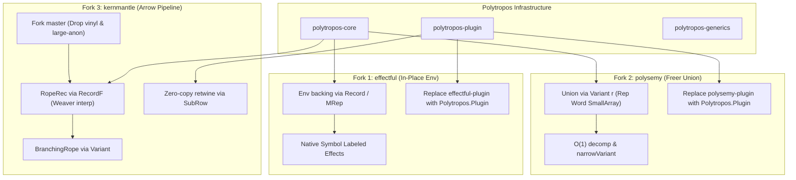

<!--
SPDX-License-Identifier: BSD-3-Clause
-->
# Design Note — Algebraic Effect Systems Porting & Forking Master Plan

Date: 2026-10-10  
Status: DRAFT v0.1 · 2026-10-10 — Master strategy for porting and forking `effectful`, `polysemy`, and `kernmantle` to `polytropos`  
Related: `POLYTROPOS_DESIGN.md` (decisions D1–D10), `SATELLITE_INTERFACES_DESIGN.md` (§2.3 ecosystem satellites), `ROW_ROLE_DEFNS_DRAFT.ott` (formal row judgements), `FIELD_UPDATE_EFFICIENCY_DESIGN.md` (transient CoW), `DOC_STRATEGY.md` (governance)  
Audience: Maintainers, compiler engineers, and library architects implementing effect system bridges.

---

## 0. Executive Summary & Architectural Thesis

Haskell's algebraic effect and extensible pipeline ecosystem is divided across three foundational operational paradigms:

1. **In-Place Environment Passing Monads (`effectful`):**  
   Effects are represented as mutable state cells and handler references held within an environment record (`Env (es :: [Effect])`). Membership `e :> es` indexes an array of references.
2. **Freer Monads & Extensible Unions (`polysemy`):**  
   Effects are GADT action descriptions wrapped in an extensible open sum union (`Union (r :: EffectRow) m a`). Handlers interpret actions by peeling off constructors using `decomp`.
3. **Arrow & Profunctor Composition Pipelines (`kernmantle`):**  
   Effects are binary profunctors / arrows ("strands") bundled into an extensible record of interpreters ("rope mantle": `record (Weaver interp) mantle`). Computations compose along an arrow pipeline.

### The Tri-Paradigm Convergence via `polytropos`

Historically, each paradigm was forced to compromise due to the absence of a unified, compile-time-efficient open ADT engine in Haskell:
- `effectful` had to invent a custom two-level mutable indirection scheme (`PrimArray Ref` pointing to a mutable `Storage` of `SmallMutableArray`) and relies on `effectful-plugin` to resolve ambiguous membership constraints.
- `polysemy` suffered severe runtime overhead and $O(N^2)$ compilation times from unary Peano proofs (`ElemOf`), nested coercions, and recursive `decomp` peeling, requiring `polysemy-plugin` to avoid exponential solver search.
- `kernmantle` originally relied on `vinyl` (linked-list heterogeneous records with $O(N)$ pointer chasing), attempted a migration to `large-anon` that stalled due to rigid kind limitations and arrow desugaring incompatibilities, and lacked first-class variant branching.

`polytropos` collapses all three paradigms into a single engine. Because `polytropos`' core representation (`Rep`: unboxed `Word` tag + flat `SmallArray` payload slots) natively accommodates both products and sums with $O(1)$ literal index synthesis via `Polytropos.Plugin`:

| System | Target Abstraction | Upstream Representation | `polytropos` Representation | Key Benefits |
|---|---|---|---|---|
| **`effectful`** | `Env (es :: RowOf Effect)` | `PrimArray Ref` + IORef `Storage` | Flat open product row `Record` / mutable transient `MRep` | Direct slot indexing via `FieldIndex`, eliminates Level-1 indirection, replaces `effectful-plugin`, native labeled effects `label ':= eff`. |
| **`polysemy`** | `Union (r :: RowOf Effect) m a` | Unary Peano `ElemOf` + `Weaving` | Open sum variant `Variant` / `RowRep SumRowT` | $O(1)$ integer tag dispatch, $O(1)$ `decomp`, eliminate `polysemy-plugin`, zero-allocation `widenVariant`/`narrowVariant`. |
| **`kernmantle`** | `Rope (mantle :: RowOf Strand)` | `Vinyl.Rec (Weaver interp)` | Flat Higher-Kinded Record `RecordF (Weaver interp) mantle` | Collapses `LooseRope`/`TightRope` to flat array, $O(1)$ strand dispatch, zero-copy `retwine` via `SubRow`, native variant strands for arrow branching. |

---

## 1. Corpus Architecture & Companion Plans

This master plan governs three dedicated, self-contained implementation blueprints:

```
docs/notes/
  ├── EFFECT_SYSTEMS_PORTING_MASTER_PLAN.md    (This master architectural synthesis)
  ├── EFFECTFUL_POLYTROPOS_PORT_PLAN.md        (Blueprint for ~/src/effectful)
  ├── POLYSEMY_POLYTROPOS_PORT_PLAN.md         (Blueprint for ~/src/polysemy)
  └── KERNMANTLE_POLYTROPOS_PORT_PLAN.md       (Blueprint for ~/src/kernmantle)
```

Each plan defines:
- Current upstream architecture and code topology.
- Structural pain points and algorithmic bottlenecks.
- The exact replacement types and data layout under `polytropos`.
- Step-by-step phased execution roadmap.
- Verification gates and performance benchmarking targets.

---

## 2. Cross-Cutting Technical Pillars

### 2.1 The Open Row Unification

All three ported libraries standardize on `polytropos`' type-level row vocabulary (`Polytropos.Core`):

```haskell
-- Effect rows are open lists of label-type bindings or effect constructors
type RowOf k = [Pair Symbol k]
type EffectRow = RowOf Effect
type StrandRow = RowOf BinEff
```

For un-labeled effects (`polysemy` and standard `effectful`), effects are identified either by their type constructor directly (`e ':= EffectRep e`), or by type-level label synthesis. For labeled effects (`Effectful.Labeled` and `kernmantle` strands), labels are native first-class type-level `Symbol`s.

### 2.2 Compiler Plugin Synergy

Each upstream library currently requires or benefits from a dedicated GHC typechecker plugin (`effectful-plugin`, `polysemy-plugin`). These plugins exist solely to overcome the limitations of GHC's typeclass resolution over open lists:
- Linear search and overlapping instance failures.
- Inability to solve membership constraints when row tails are polymorphic.
- Exponential constraint expansion in large effect stacks.

Under the porting roadmap, all three libraries replace their bespoke plugins with **`Polytropos.Plugin`**:
1. **`FieldIndex name r a`:** Solves static member offsets directly to unboxed `Int#` literals in Core AST.
2. **`ConstructorIndex name r a`:** Solves variant constructor tags directly to unboxed `Word#` literals.
3. **`SubRow sub super`:** Solves record projection and reordering evidence (`subRowIndices :: [Int]`) in $O(M)$ compile time, emitting flat slice indices.
4. **`SubSum sub super`:** Solves variant injection (`subSumInjectIndices :: [Word]`) and narrowing (`subSumNarrowIndices :: [Maybe Word]`).
5. **`KnownHash name`:** Computes FNV-1a 64-bit label hashes at compile time for dynamic label dispatch.

This shared infrastructure reduces ecosystem maintenance overhead from four disparate compiler plugins down to one verified, zero-log plugin.

### 2.3 Memory Layout & Vectorized Transients

Upstream effect libraries suffer from memory fragmentation:
- `vinyl` allocates $O(N)$ heap cons cells `(:&)` for $N$ strands.
- `polysemy` allocates $O(1)$ to $O(N)$ Peano tokens (`There (There Here)`) per action.
- `effectful` allocates a secondary `PrimArray Ref` mapping to resolve dynamic stack displacements.

`polytropos` uses a flat `SmallArray` payload. In GHC's runtime:
- `SmallArray#` has zero pointer-chasing overhead across slots.
- Indexing an effect handler is a single machine memory dereference (`base + offset * wordSize`).
- Copy-on-Write (CoW) updates (`setFieldAt`, `setFieldsAt`) utilize hardware-accelerated memory block copies (`copySmallArray#`).
- Transient environment mutations (`thawRep`, `freezeRep`, `MRep`) allow zero-allocation localized batch configuration.

---

## 3. High-Level Dependency Graph & Sequencing



---

## 4. Work Tracking and Milestone Schedule

| Milestone | Package Target | Primary Objectives | Deliverables |
|---|---|---|---|
| **M1** | `effectful` | Port `Effectful.Internal.Env` to open rows; replace `(:>)` with `FieldIndex`; deprecate `effectful-plugin`. | `effectful-core` compiling cleanly with `polytropos-plugin`. |
| **M2** | `polysemy` | Replace `Union` and `ElemOf` with `Variant` and `ConstructorIndex`; implement $O(1)$ `decomp`; eliminate `polysemy-plugin`. | `polysemy` test suite passing with flat variant representations. |
| **M3** | `kernmantle` | Fork from `master` (commit `11431c0`); replace `vinyl` with `RecordF`; unify `LooseRope` and `TightRope`. | `kernmantle` examples (`ex1`, `exBypass`, `exCli`) compiling and executing with zero vinyl references. |
| **M4** | Ecosystem Integration | Cross-effect benchmarks (`effects-zoo`); performance comparisons against vanilla upstream checkouts. | Comparative benchmark suite in `benchmark/effects/`. |

Detailed operational instructions, file inventories, diff specifications, and verification gates for each target package follow in the respective companion plans.
