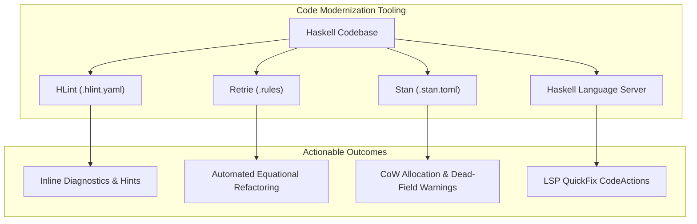

# Polytropos Modernizer & Linter Guide (Milestone T6)

This guide documents the semantic refactoring rules, linters, and static analysis guardrails provided by `polytropos` for automated codebase modernization and performance verification.

---

## 1. Architecture Overview

As codebases migrate from legacy nominal ADTs and extensible record libraries (`vinyl`, `large-records`, `generic-lens`) to `polytropos`, developers benefit from automated tooling that:
1. Upgrades verbose manual idioms (e.g. `getField @"val" r`) to ergonomic native syntax (`r.val`).
2. Detects performance anti-patterns (such as repeated Copy-on-Write single-field updates in loops) and suggests batching (`setFieldsAt` or transient `runMRep` builders).
3. Recommends total, $\mathcal{O}(1)$ jump-table variant elimination (`eliminateUniform`) over fragile $\mathcal{O}(N)$ cascading `case` statements.
4. Integrates seamlessly into local CLI scripts, CI workflows, and IDEs via `haskell-language-server` plugins.



---

## 2. Rule Catalog

### 2.1 Native `OverloadedRecordDot` (`Use OverloadedRecordDot`)
- **Found:** `getField @"user" record`
- **Perhaps:** `record.user`
- **Rationale:** GHC 9.2+ native `OverloadedRecordDot` is fully solved by `Polytropos.Plugin` into literal $\mathcal{O}(1)$ array index lookups, eliminating explicit proxy applications and improving readability.

### 2.2 Chained Field Update Prevention (`Avoid chained setField`)
- **Found:** `setField @"a" u (setField @"b" v r)`
- **Perhaps:** `runMRep (setFieldM @"a" u >> setFieldM @"b" v) r` or `setFieldsAt [(idxA, u), (idxB, v)] r`
- **Rationale:** `setField` performs a Copy-on-Write (CoW) allocation of the record payload array. Chaining $K$ calls causes $K-1$ wasted intermediate heap allocations. `runMRep` performs all modifications in-place in a transient mutable array before freezing, taking exactly one allocation.

### 2.3 Hot-Loop Update Batching (`Avoid repeated setField in foldl`)
- **Found:** `foldl (\acc (k, v) -> setField k v acc) initialRecord pairs`
- **Perhaps:** `runMRep (traverse_ (uncurry setFieldM) pairs) initialRecord`
- **Rationale:** Inside a loop of length $M$, calling `setField` allocates $\mathcal{O}(M \cdot N)$ memory. The transient builder reduces this to $\mathcal{O}(N)$.

### 2.4 Single-Constructor Peeling (`Use peel for single-constructor elimination`)
- **Found:** `case narrowVariant x of { Just a -> b; Nothing -> c }`
- **Perhaps:** `case peel x of { Right a -> b; Left remainder -> c }`
- **Rationale:** `peel @"tag"` provides direct $\mathcal{O}(1)$ tag matching, returning `Right payload` if matched, and `Left rest` with an exact, definitionally narrowed remainder row `Variant (Delete tag row)`.

### 2.5 Total Jump-Table Elimination (`Use eliminateUniform for handler dispatch`)
- **Found:** `matchVariant x handlers`
- **Perhaps:** `eliminateUniform handlers x`
- **Rationale:** `eliminateUniform` compiles directly into an $\mathcal{O}(1)$ jump table indexed by constructor tag, verifying full row exhaustiveness at compile time.

### 2.6 Redundant Variant Widening (`Redundant widenVariant`)
- **Found:** `widenVariant x` where the row types are identical
- **Perhaps:** `x`
- **Rationale:** Strips unnecessary no-op subtyping evidence casts from Core.

### 2.7 Syntactic Sugar Adoption
- **Found:** `insertField @"x" u (insertField @"y" v emptyRecord)` $\implies$ `REC { x = u, y = v }`
- **Found:** `injectVariant @"err" e` $\implies$ `VAR { err = e }`

---

## 3. Running Modernization Tools

### 3.1 Using `bin/polytropos-modernize`
A unified CLI runner is included in the project:

```bash
# Check code against polytropos lint rules:
./bin/polytropos-modernize --check packages/

# Automatically apply supported refactorings in-place:
./bin/polytropos-modernize --apply src/MyModule.hs

# List all active HLint rules:
./bin/polytropos-modernize --rules

# List available Retrie equational rewrite files:
./bin/polytropos-modernize --retrie-rules

# View Stan static analysis inspection specification:
./bin/polytropos-modernize --stan-spec
```

### 3.2 Using `retrie` for Automated Equational Rewrites
Retrie equational rule files are located in `rules/retrie/`:
- `rules/retrie/record-dot.rules`: Migrates `getField` to `r.field`.
- `rules/retrie/batch-updates.rules`: Coalesces sequential `setField` calls into transient builders.
- `rules/retrie/variant-eliminators.rules`: Modernizes variant dispatch to `eliminateUniform`.
- `rules/retrie/open-adt-migration.rules`: Migrates legacy nominal representations to `REC` and `VAR`.

To apply an equational rule across a codebase:
```bash
retrie --adhoc "forall r. getField @\"name\" r = r.name"
retrie --adhoc "forall h v. matchVariant v h = eliminateUniform h v"
```

### 3.3 Using `stan` Static Analysis
Run Stan using the project-level configuration:
```bash
stan --config-file=.stan.toml
```
Stan will detect CoW loop allocations, dead row fields, and redundant variant conversions across the compiled `.hie` files.

---

## 4. IDE Integration (Haskell Language Server)

When developing in VS Code, Neovim, or Emacs with `haskell-language-server`:
1. **`hls-hlint-plugin`:** Reads `.hlint.yaml` automatically from the project root and highlights suggestions inline.
2. **`hls-retrie-plugin`:** Exposes retrie equational rewrites as one-click CodeActions on matching AST nodes.
3. **`hls-stan-plugin`:** Surfaces static analysis warnings for hot loops and redundant conversions.
4. **`hls-case-split-plugin` / Wingman:** Provides exhaustive constructor expansion for `Variant s` patterns.
